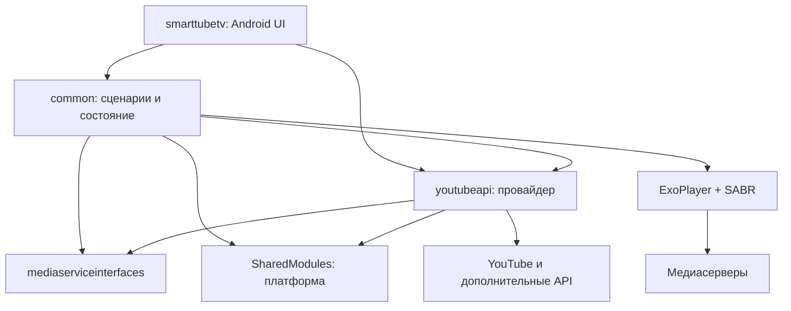
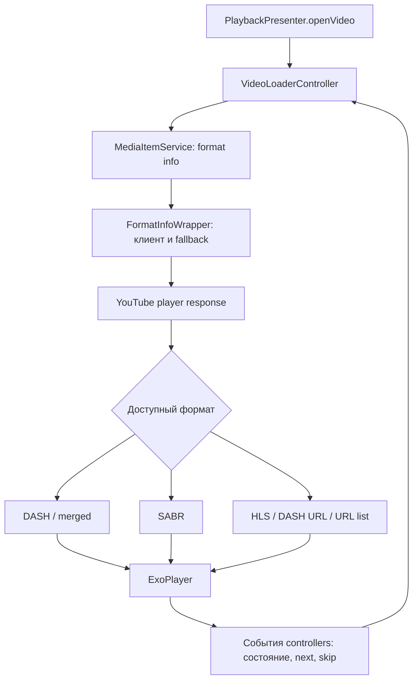

# Текущая архитектура

Версии и навигация: [ARCHITECTURE.md](../../ARCHITECTURE.md). Номера S01–S25 отсылают к [карте исходников](sources.md).

## Устройство проекта

Это Gradle multi-project Android-приложение на Java/Kotlin. Организация напоминает MVP: Android Views вызывают presenters, те обращаются к медиапровайдеру и обновляют представления. Однако Android-зависимости проходят через presenters и модели; строгого разделения на независимый домен и платформенные адаптеры нет.

| Модуль / каталог | Ответственность | Существенные зависимости |
| --- | --- | --- |
| `smarttubetv` | APK, `MainApplication`, Activities/Fragments, карточки, фокус и управление с пульта | `common`, Leanback, Fragment, Glide, ExoPlayer UI/MediaSession, `youtubeapi` |
| `common` | Сценарии поиска/каталога/плеера, состояние, настройки, player controllers, интеграция ExoPlayer | Android, RxAndroid, `youtubeapi`, `mediaserviceinterfaces`, `sharedutils`, ExoPlayer |
| `MediaServiceCore/mediaserviceinterfaces` | Контракты каталога, видео, входа, комментариев, чата, remote control; модели ответов | Android library, RxJava/RxAndroid, `sharedutils`; отдельные Android-типы |
| `MediaServiceCore/youtubeapi` | Реализация контрактов: browse/search/next/player, auth, форматы, дополнительные провайдеры | Retrofit/Gson, OkHttp, Android helpers, WebView/V8, общие настройки |
| `SharedModules/sharedutils` | Preferences, Rx helpers, HTTP и системные утилиты, логирование | Android и RxAndroid |
| `SharedModules/appupdatechecker2` | Обновление Android-приложения | Android |
| `SharedModules/j2v8` | Нативная Java ↔ V8 интеграция | Android JNI/ABI |
| `SharedModules/sharedtests`, `commons-io-2.8.0` | Тестовые helpers; vendored IO-библиотека с адаптациями | Проверять при точечном извлечении |
| `exoplayer-amzn-2.10.6` | Локальное дерево ExoPlayer с расширениями, включая SABR | Android media stack, сетевые адаптеры, protobuf для SABR |
| `leanback-1.0.0`, `fragment-1.1.0` | Локальные версии Android UI-библиотек | Android/AndroidX |
| `leanbackassistant` | Интеграция с Android TV, каналы/рекомендации | Android TV |
| `chatkit`, `filepicker-lib`, `doubletapplayerview`, `slidableactivity` | Виджеты чата, файловый диалог, жесты и Activities | Android UI |

Состав подключаемых проектов определяют `settings.gradle` и `core_settings.gradle` подмодулей (S01–S03). Не каждый каталог vendored ExoPlayer — активная зависимость APK. Название `2.10.6` нельзя использовать как полное описание возможностей: в дереве есть собственный `library/sabr`.

Стрелки показывают существенные зависимости/обращения, а не полный Gradle-граф. `MediaServiceManager` приложения и `YouTubeServiceManager` провайдера — разные классы: первый координирует загрузку и UI-состояние, второй предоставляет реализации контрактов. Часть presenters обращается к провайдеру напрямую через базовый класс, поэтому единой обязательной прослойки между всем UI и `youtubeapi` нет (S06, S09, S10).

## Запуск и навигация

`MainApplication` наследует `MultiDexApplication`, настраивает обработку ошибок и WorkManager и регистрирует соответствие `BrowseView → BrowseActivity`, `PlaybackView → PlaybackActivity` и других экранов в `ViewManager` (S04). Это точка сборки Android-интерфейса, а не универсальный web-router.

В `common/app/views` есть интерфейсы представлений, но `BasePresenter` хранит слабые ссылки на `Activity`/`Context`, определяет жизнеспособность View/Fragment и управляет платформенными побочными эффектами (S06). Замена одной реализации `BrowseView` на HTML не устраняет эту связность.

## Поток поиска и каталога

1. Экран вызывает `SearchPresenter.onSearch(query)`.
2. `loadSearchResult` очищает выдачу, показывает загрузку и вызывает `ContentService.getSearchObserve` с набором фильтров.
3. `YouTubeContentService` обращается к соответствующим browse/search реализациям; ответы становятся `MediaGroup`/`MediaItem`.
4. Presenter преобразует их в `VideoGroup`/`Video`, обновляет View и запускает дополнительную обработку через `BrowseProcessorManager`.
5. Дозагрузка использует `continueGroupObserve(mediaGroup)`: page key принадлежит провайдеру, это не просто числовой offset.
6. Presenter освобождает Rx-подписки при уничтожении View; ошибки и состояние загрузки обрабатываются отдельно.

Источники: S07, S08, S10. В web-переносе нужно сохранить отмену устаревшего поиска, защиту от результатов предыдущего запроса и непрозрачные continuation tokens.

## Поток воспроизведения

`PlaybackPresenter` рассылает события списку controllers. Порядок регистрации явно значим: `VideoStateController`, `SuggestionsController`, `VideoLoaderController`, `ErrorFixerController`, затем UI/remote/SponsorBlock/AFR/HQ/chat/comments (S11). Это координация через события и общий player, а не набор полностью независимых модулей.

`VideoLoaderController` получает `MediaItemFormatInfo` и выбирает путь: adaptive DASH (при условиях — объединение с HLS), SABR, live DASH URL, live HLS, обычные URL; отдельно обрабатывает непроигрываемое и ожидаемое live-видео. Точный выбор зависит от настроек и predicates, это не гарантия наличия каждого fallback (S12).

`PlayerManager` объединяет `PlayerEngine` и `PlayerUI`. Сам `PlayerEngine` содержит `InputStream`, `MediaItemFormatInfo` и ExoPlayer-ориентированный `FormatItem`; его нельзя использовать как готовый HTTP/JSON-контракт (S13). `ExoPlayerController` и `ExoMediaSourceFactory` создают источники и управляют движком; SABR также имеет live timeline/seek-логику (S14).

## Где находится знание о YouTube

`YouTubeServiceManager` выдаёт content/media/sign-in/chat/comments/remote реализации и управляет инвалидированием кэша/сменой клиента. `FormatInfoWrapper` выбирает primary/secondary provider между legacy и Innertube, кэширует format info и учитывает auth/reload context (S10, S15).

`MediaItemFormatInfo` включает не только URL, но и adaptive formats, subtitles, создание MPD, SABR URL, ustreamer config, poToken, visitor cookie и профиль клиента (S16). Поэтому модель «сервер один раз возвращает ссылку на MP4» не отражает действующий медиатракт.

`WebPoTokenProvider` создаёт генератор с Android Context и WebView, отслеживает срок действия и visitor/streaming state; существуют альтернативные генераторы V8/WebView (S17). Наличие JavaScript assets не делает этот код готовым для обычной страницы другого origin.

`library/sabr` содержит ExoPlayer media source/period/chunk source, обработчик протокола, UMP framing, protobuf-схемы и извлечение кадров. Даже `UMPDecoder` принимает ExoPlayer `ExtractorInput` и использует shared helpers (S18). Извлекать придётся по слоям: схемы и протокол отдельно, адаптер к движку отдельно.

## Состояние, асинхронность и дополнительные функции

- `Video` — изменяемая модель с metadata, UI-флагами, queue/playlist context и Android helpers; это не чистый DTO. `Playlist` — singleton, ограничение размера выбирается через проверку памяти устройства (S19).
- `VideoStateService` хранит состояние просмотра отдельно от экземпляра `Video`, связан с профилем и `AppPrefs`. Это полезная семантика для переноса; storage/timers необходимо заменить (S20).
- `AppPrefs` основан на `SharedPreferencesBase` и реагирует на смену аккаунта. `YouTubeSignInService` использует singleton account manager и общие auth headers (S21, S22).
- RxJava сам по себе не требует Android, но местный `RxHelper` использует `AndroidSchedulers`, shared helpers и общую настройку выполнения (S23).
- SponsorBlock: получение сегментов находится в `youtubeapi/block`, решение о пропуске, отображение и управление плеером — в `SponsorBlockController`. DeArrow также имеет отдельный провайдер данных. Семантика переносима, текущий controller зависит от Android UI и настроек (S24).

**Следствие для серверного переиспользования:** нельзя просто поднять существующие singleton-провайдеры как многопользовательский backend. Auth headers, выбранный аккаунт, visitor state, client fallback и кэши необходимо сделать scoped по сессии/аккаунту. Потокобезопасность отдельных методов не обеспечивает изоляцию пользователей.

## Что измерено

Подсчитаны `.java`/`.kt` в `src/main/**/*` выбранных модулей и файлы с прямым `import android.` либо `import androidx.`. Включены annotations; транзитивные зависимости не учитывались.

| Модуль | Файлов | С прямым Android/AndroidX import |
| --- | ---: | ---: |
| `smarttubetv` | 186 | 179 |
| `common` | 211 | 149 |
| `mediaserviceinterfaces` | 34 | 6 |
| `youtubeapi` | 411 | 63 |
| `sharedutils` | 58 | 42 |
| `library/sabr` | 67 | 18 |

Это индикатор связности, **не процент готового к переиспользованию кода**. Например, `Playlist` зависит от Android косвенно, а AndroidX annotation может быть гораздо проще удалить, чем один вызов WebView. В `mediaserviceinterfaces` есть и реальные платформенные типы: `MediaItem` импортирует `android.media.Rating`, `ChannelGroupService` — `android.net.Uri`.

Существуют тесты провайдера (включая mocks и Android instrumentation) и SABR; их не запускали. Сборка зависит от Android SDK и старого toolchain; upstream README отдельно указывает OpenJDK 14 или старее. Для будущей работы фиксировать три SHA и не заменять их плавающими HEAD. `settings.gradle` умеет выбирать соседние checkout-папки подмодулей — это потенциальный источник невоспроизводимой сборки.
