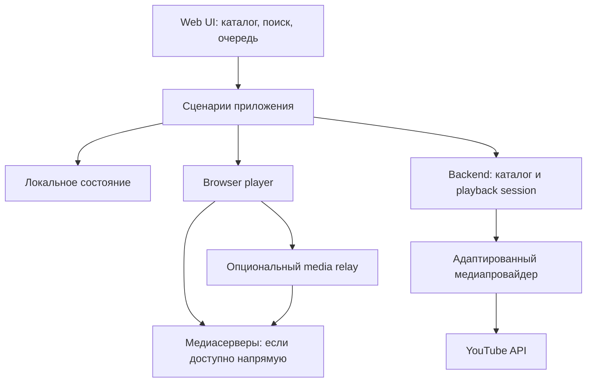

# Перенос SmartTube в браузер

Этот документ — проектное предложение по результатам [анализа кода](current.md), а не описание уже существующего web-приложения. Исходные файлы и ссылки на web-стандарты: [sources.md](sources.md).

## Что означает переиспользование

Различаем: **готовые данные/схемы**, **извлечение JVM-кода для backend**, **перенос поведения в TypeScript**, **полная замена платформенной реализации**. JVM-код не исполняется непосредственно в обычном браузере. Компиляция Java в JS/Wasm сама по себе не предоставляет Android SDK, MediaCodec, WebView, JNI и произвольный HTTP-клиент.

| Часть SmartTube | Android-специфика | Повторное использование в web-проекте | Что сделать |
| --- | --- | --- | --- |
| `smarttubetv`, Leanback, Fragment, UI-библиотеки | Высокая | Сценарии, тексты и визуальные ориентиры | Новый DOM/CSS UI с touch, mouse, keyboard и TV focus |
| `BasePresenter`, `ViewManager` | Activity/Context/lifecycle | Идеи сценариев | Web-router и lifecycle отменяемых задач |
| Browse/Search presenters | Смешана с логикой | Фильтры, pagination, преобразования выдачи | Перенести сценарии; не тащить UI resources и singletons |
| `Video`, `VideoGroup`, `Playlist` | Прямая и транзитивная | Доменная семантика очереди и metadata | Разделить DTO, queue state и UI state; задать лимиты явно |
| `mediaserviceinterfaces` | Android build, Rx и отдельные Android-типы | Основа контракта; части извлекаемы в JVM | Узкие DTO/JSON-контракты без `Rating`, `Uri`, `InputStream` и Observable на wire |
| `youtubeapi` browse/search/next parsers | Частично через helpers/runtime | Ценный кандидат на JVM extraction; либо порт парсеров | Выделить HTTP, clock, storage, session; fixtures для разных ответов |
| Format selection и MPD/storyboard builders | Смешанная | Алгоритмы и данные форматов | Извлекать точечно после проверки зависимостей; не обещать готовый jar |
| Auth, visitor state, poToken | Preferences, WebView/V8, global state | Протокольная модель и жизненный цикл | Новый session-scoped runtime; отдельная проверка browser/backend применимости |
| SABR protobuf-схемы | Независимы от Android runtime | Наиболее прямое переиспользование схем | Генерация типов для выбранного языка, проверка атрибуции |
| SABR/UMP parser | ExoPlayer input/helpers и связанные типы | Протокольная логика, fixtures | Отделить framing/state machine от ExoPlayer |
| ExoPlayer engine/source/codec/surface | Высокая | Только спецификация ожидаемого поведения | HTML media + MSE-плеер; отдельный SABR adapter при необходимости |
| SponsorBlock/DeArrow | Провайдер данных частично переносим; controller платформенный | Категории, правила skip, преобразования metadata | Новый fetch/storage/player adapter и UI |
| `AppPrefs`, `VideoStateService` | SharedPreferences и lifecycle | Модель профилей, resume/progress | IndexedDB для локального состояния; backend для синхронизации при необходимости |
| Remote control / TV linking | Протокол + Android service/UI | Протокол после отдельного исследования | Новая сессия приёмника, доставка команд в web-клиент; не считать готовым Chromecast |
| AFR, launcher channels, bridge apps, APK updater | Android/TV platform | Практически нет | Исключить из MVP; браузерные возможности добавлять отдельно |
| Тестовые ответы, локализация, изображения | Форматы Android resources | Данные/ожидаемые результаты | Конверсия; очистка fixtures от сессионных данных; учёт исходных лицензий |

## Рекомендуемая начальная архитектура

Начать с **web-клиента и небольшого backend-медиапровайдера**. Это рабочая гипотеза: backend проще изолирует специфичную сеть и runtime провайдера, а Java/Kotlin-код можно извлекать постепенно. Успешность воспроизведения из облачного окружения ещё нужно доказать.

На схеме relay условный. Получение metadata на backend не доказывает, что поток можно получить с IP браузера. Нужно проверить lifetime URL, связь с сессией/IP, заголовки, CORS и формат. Если нужен relay, это отдельный расход трафика и отдельный модуль с streaming/backpressure, Range/seek и закрытием upstream при отмене. Не буферизовать целое видео. Допускать только источники, выданные медиапровайдером, а не произвольный URL от клиента.

Для первого варианта не нужен набор микросервисов. Один backend с внутренними модулями достаточен. Выбор JVM extraction против TypeScript-провайдера сделать после playback spike: экономия на повторном использовании может оказаться меньше стоимости удаления Android-связности.

### Узкие интерфейсы

Не переносить весь `ServiceManager` или `PlayerManager` один к одному. Начальные интерфейсы скрывают протокол и runtime:

| Модуль | Минимальные операции | Инварианты и ошибки |
| --- | --- | --- |
| Catalog | `search(query, filters, cursor)`, `browse(section, cursor)` | Cursor непрозрачный и привязан к запросу/сессии; отмена и отклонение устаревших ответов |
| Playback provider | `resolve(videoId, capabilities, session)`, `refresh(playbackSessionId)` | Источники ограничены временем/сессией; явные `unavailable`, `auth_required`, `unsupported`, `retryable` |
| Player | `load(source)`, `play`, `pause`, `seek`, `selectTrack`, `dispose` | Отдельные события ready/buffering/error/ended; очистка ресурсов, допустимый seek range |
| Watch state | `read(profileId, videoId)`, `write(progress)` | Изоляция профилей; позиция в миллисекундах; stale updates не перетирают новую сессию |
| Segment policy | `nextAction(positionMs, segments, settings)` | Чистая функция выбора skip/notification/no-op; время нормализовано |

`resolve` возвращает DTO с типом транспорта, доступными дорожками/кодеками, live/seek-параметрами, информацией об истечении (если известна) и идентификатором playback session. Это может быть URL манифеста, progressive source или описание поддерживаемого специального транспорта — нельзя обещать, что любой SABR-ответ автоматически станет DASH.

Если провайдер работает на backend, токены аккаунта и служебные cookies остаются в нём; web получает ограниченный контракт. Все provider singletons с изменяемым auth/visitor/client state должны быть переработаны или процесс изолирован на пользователя. Для MVP разумно начать без входа; это снижает объём реализации, но не гарантирует доступность всех видео.

## Почему обычная статическая страница пока не доказана

| Вариант | Плюсы | Ограничения | Решение для старта |
| --- | --- | --- | --- |
| Только web/PWA | Нет собственного сервера и его трафика | CORS, управляемые браузером headers/cookies, token runtime, SABR | Отдельный эксперимент; не считать гарантированным вариантом |
| Web + backend | Можно извлекать JVM-код, централизовать provider fixes | Сессии, cloud IP, возможный relay и стоимость | Рекомендуемый первый spike |
| Web + локальный companion | Провайдер рядом с пользователем | Нужна установка и управление локальным процессом | Резервный вариант, если облачный медиатракт не подходит |
| Browser extension | Дополнительные разрешения платформы | Установка, поддержка браузеров/планшетов/TV, всё ещё новый плеер | Другая модель продукта; не подразумевается запросом |

Fetch/CORS ограничивает чтение cross-origin ответов и управление некоторыми заголовками. `no-cors` даёт opaque response, а не доступ к байтам для парсера/MSE. Service Worker не отменяет эти ограничения. При этом обычное встраивание media и программная загрузка сегментов — разные случаи; нельзя утверждать, что любое `<video src>` всегда требует одного и того же CORS-пути. Проверять конкретный transport (W01).

MSE позволяет подавать поддерживаемые media segments в браузерный плеер; это не универсальный декодер сетевых протоколов. Для SABR нужен parser/adapter и корректный выходной byte stream. Проверять MIME+codecs, timestamps, audio/video sync и backpressure; наличие MSE не гарантирует 4K/HDR или поддержку каждого кодека (W02–W04).

Android background service, AFR и lifecycle не имеют прямого эквивалента в web. Для autoplay предусмотреть явный пользовательский запуск и обработку отказа `play()`; возможность background/PiP проверять на целевых браузерах (W05). Не объявлять паритет с Android до измерений.

## Последовательность разработки и критерии завершения

| Этап | Результат | Проверка / условие перехода |
| --- | --- | --- |
| 0. Зафиксировать базу | Три SHA, минимальный provider harness, несколько обезличенных fixtures | Подмодули воспроизводимы; понятно, какой runtime нужен для получения format info |
| 1. Playback spike — главный барьер | Реальное видео в целевом браузере через выбранный provider | Звук+видео, seek вперёд/назад, длительное воспроизведение, refresh источника, повторное открытие, отмена; записать фактический transport |
| 2. Решить topology | Прямой media fetch либо relay, локальный либо облачный provider | Проверены разные сети/IP и CORS; успешность на одном ролике не объявляется общей |
| 3. Вертикальный MVP | Поиск → результаты → открытие → очередь → resume | Pagination, быстрые смены запроса/видео, недоступное видео, reload страницы; touch и keyboard |
| 4. SmartTube-функции | SponsorBlock, выбор качества/аудио/субтитров, настройки | Skip на границах сегментов, ручной seek, смена дорожек без потери позиции |
| 5. Аккаунты | Вход, выбор профиля, подписки и история | Независимость двух сессий, logout, refresh, отсутствие смешивания кэшей/заголовков |
| 6. Live и расширения | Live/DVR, chat, remote control, DeArrow по приоритету | Live edge/seek window/reconnect, остановка фоновых запросов, платформенные ограничения |

Минимальная playback-матрица: обычное VOD с раздельными audio/video, длинное VOD, SABR-источник если встречается, live/DVR на соответствующем этапе, недоступное видео, истечение URL/сессии, смена качества, сетевая ошибка. Отдельно проверить Chromium на Android-планшете, desktop Chromium и Firefox; Safari включать, если нужен. Не подменять реальную проверку сетевого медиатракта тестовыми роликами, раздаваемыми собственным сервером.

### Тестовые границы

- Parser fixtures: ответы каталога/player → стабильные DTO; неизвестные поля и пустые группы.
- Queue/segment policy: переходы next/repeat/shuffle и skip, без Android и сети.
- Provider contract: cancellation, timeout, refresh, различение ошибок; отдельно интеграционные проверки реального сервиса.
- Browser player: seek/ended/load cancellation, audio/video sync, ограничения буфера и `dispose`.
- Session isolation: параллельные аккаунты не делят заголовки, cursors, кэш форматов и visitor state.

Сначала извлекать код, необходимый для работающего вертикального сценария; не строить универсальный framework для всех возможных провайдеров. Для каждого перенесённого алгоритма сохранять upstream-путь/SHA и fixture, чтобы последующие исправления можно было сопоставить с оригиналом.

## Что остаётся неизвестным

Не проверены фактическая работоспособность YouTube-запросов и токенов из выбранного server runtime, прямой media fetch из браузера, необходимый объём relay, поддержка SABR выбранным web-плеером и точная стоимость JVM extraction. Эти вопросы закрывает этап 1–2; статический анализ не даёт оснований обещать browser-only, полный паритет или срок реализации.

Корневые LICENSE основного репозитория и двух подмодулей обозначены MIT, но vendored файлы и заимствованные части имеют свои notices. При переносе сохранять их и учитывать происхождение конкретных файлов; корневая лицензия не заменяет проверку включаемых зависимостей. Это техническая отметка о составе исходников, не юридическое заключение.
